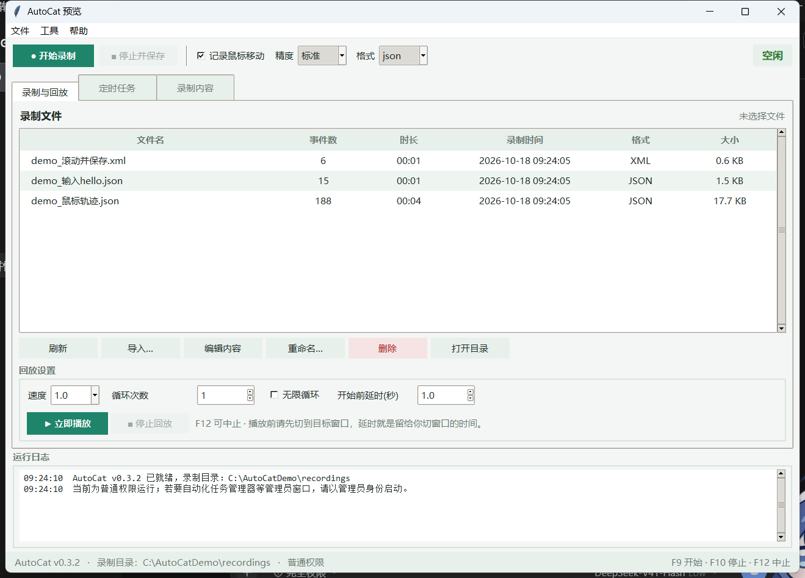
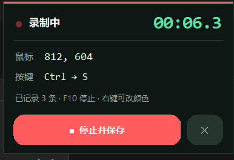
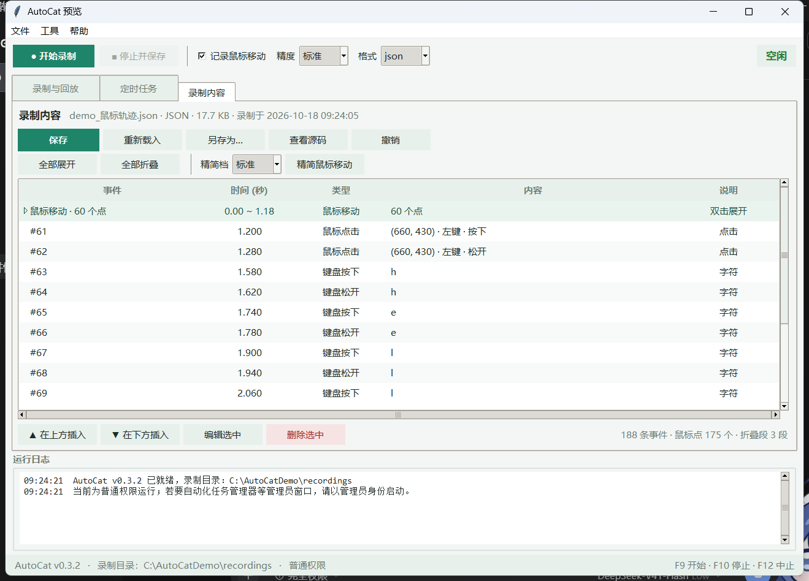
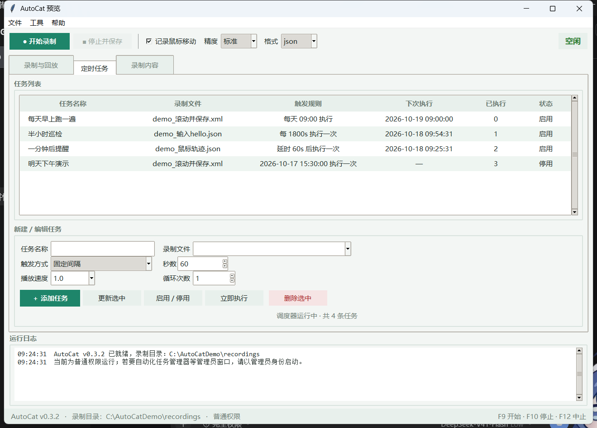

# AutoCat

> Windows 键鼠录制、回放与定时自动化工具  
> A Windows keyboard & mouse recorder, player, and scheduler built with Python + tkinter.

[](https://www.python.org/)
[](#)
[](https://github.com/KanzakiRyo99/AutoCat/releases)
[](tests)
[](LICENSE)

AutoCat 用 Python + tkinter 写成，除 `pynput` 外没有第三方依赖。  
它把「录制一段键鼠操作 → 回放 → 定时执行」这条链路做成了一个可以直接用的小工具，
并且额外处理了几个实际使用中很容易踩的坑：鼠标轨迹过大、录制时看不到状态、
录完的文件不好改、以及 Windows UIPI 导致回放「鼠标能动但键盘没反应」。

---

## 目录

- [功能](#功能)
- [界面截图](#界面截图)
- [安装](#安装)
- [快速开始](#快速开始)
- [使用指南](#使用指南)
- [鼠标记录体积优化](#鼠标记录体积优化)
- [管理员权限与 UIPI](#管理员权限与-uipi)
- [文件格式](#文件格式)
- [命令行](#命令行)
- [定时任务](#定时任务)
- [配置文件](#配置文件)
- [项目结构](#项目结构)
- [开发与测试](#开发与测试)
- [打包与图标](#打包与图标)
- [已知限制](#已知限制)
- [贡献](#贡献)
- [隐私与免责声明](#隐私与免责声明)
- [许可证](#许可证)
- [作者](#作者)

---

## 功能

| 能力 | 说明 |
|---|---|
| 录制 | 全局热键 F9 开始、F10 停止；记录鼠标移动、点击、滚轮、键盘按下/松开 |
| 悬浮窗 | 录制时主窗口最小化，右上角显示圆角半透明状态卡：计时、坐标、最近按键、停止/取消 |
| 鼠标瘦身 | 三档预设，按距离/时间采样 + Douglas–Peucker 路径简化，典型体积降到 1/6 ~ 1/3 |
| 回放 | 0.25x–5x 变速、循环、无限循环、播放前延时、F12 中止、防卡键 |
| 可视化编辑 | 主界面折叠查看鼠标移动段，双击改字段，任意位置插入事件，保存回 JSON/XML |
| 定时 | 指定时刻一次 / 延时一次 / 固定间隔 / 每天定时，任务持久化到 `schedules.json` |
| 权限诊断 | 检测输入被 UIPI 拦截，明确提示原因，并支持一键以管理员身份重启 |
| 界面 | 浅色青绿主题、分组工具条、斑马纹列表、空状态提示、底部状态栏、自绘图标 |
| 格式 | JSON / XML 双向兼容，可直接用文本编辑器修改 |
| 依赖 | 仅 `pynput>=1.8.0`；tkinter 为 Python 自带 |

## 界面截图



<p align="center">
  
</p>





## 安装

### 环境要求

- Windows 10 / 11（主要开发与测试于 Windows 11）
- Python 3.9+
- 可用的桌面会话（AutoCat 需要全局键鼠钩子）

### 从源码安装

```bash
git clone https://github.com/KanzakiRyo99/AutoCat.git
cd AutoCat

python -m venv .venv
.venv\Scripts\activate

pip install -r requirements.txt
python main.py
```

也可以直接下载仓库 ZIP 解压，双击 `start_autocat.bat`，或者运行 `python main.py`。

窗口和任务栏图标来自 `assets/autocat.ico`，是项目自绘素材，不依赖第三方图标库。

## 快速开始

1. 点 **● 开始录制**（或按 F9），主窗口最小化，右上角出现录制悬浮窗；
2. 操作你的目标软件，按 **F10** 或点悬浮窗 **■ 停止并保存**；
3. 回到主界面，选中刚录的文件，设置速度/循环，点 **▶ 立即播放**；
4. 想让它自动执行，切到 **定时任务** 标签页添加任务。

> 首次使用可以先播放 `recordings/demo_输入hello.json` 体验时序；
> 演示文件由 `python tools/make_demo.py` 生成，删除后可以随时重建。

## 使用指南

### 录制与回放

- **开始录制**：F9，或工具条按钮。主窗口会最小化，避免挡住操作。
- **停止并保存**：F10，或悬浮窗 **■ 停止并保存**。保存时按当前「精度」档自动精简鼠标轨迹。
- **取消录制**：悬浮窗 **✕**，本次内容不保存。
- **回放**：选中列表中的文件后点 **▶ 立即播放**；开始前延时用于切换到目标窗口。
- **中止回放**：F12，或 **■ 停止回放**。
- **录制内容** 标签页可以直接查看、修改、插入事件，详见下文。

### 录制悬浮窗

- 置顶、半透明、可拖动，圆角卡片 + 圆角按钮。
- 顶部红色状态条和闪烁录制点提示正在录制，右侧是大号计时。
- 显示鼠标实时坐标、最近按下的键、已记录事件数。
- 右键菜单：改文字颜色、恢复默认颜色、切换左上/右上角、调整透明度。
- 悬浮窗覆盖区域内的鼠标事件会被录制器忽略，点按钮不会污染录制。
- 默认透明度 92%，可以在设置或右键菜单里调整。

### 录制内容编辑器

在「录制与回放」中选中文件，点 **编辑内容**，或直接切到 **录制内容** 标签页：

- 连续的 `mouse_move` 自动合并成「鼠标移动 · N 个点」分组，默认折叠；
- 双击分组展开/折叠，双击行内任意位置（或按 F2）修改时间、按键、坐标、按钮状态；
- 选中事件后，用 **▲ 在上方插入** / **▼ 在下方插入** 添加自定义事件，
  时间会自动取前后两条的中点；
- **精简鼠标移动** 可以用当前档位压缩已经录好的大文件，支持撤销；
- **保存** 写回原 JSON/XML，保留 `meta` 和录制时间，保存时按时间排序；
- **查看源码** 可以直接看到当前编辑内容序列化后的 JSON/XML。

### 定时任务

| 触发方式 | 参数 | 说明 |
|---|---|---|
| 指定时刻一次 | `YYYY-MM-DD HH:MM:SS` | 到点执行一次，过期不再触发 |
| 延时一次 | 秒数 | 从添加时起 N 秒后执行一次 |
| 固定间隔 | 秒数 | 每 N 秒执行一次；休眠错过的次数不补跑，直接推到下一个未来时刻 |
| 每天定时 | `HH:MM` | 每天这个时间执行 |

任务保存在 `schedules.json`。调度器只有一个工作线程，任务串行执行，
不会出现两个回放同时抢占键鼠。无界面场景可以运行：

```bash
python main.py serve
```

## 鼠标记录体积优化

鼠标移动通常是录制文件里最大的部分。AutoCat 在**录制结束时**做两步处理：

1. **采样**：距离小于阈值、或时间间隔过短的点直接丢弃；
2. **路径简化**：对每段连续移动运行 Douglas–Peucker（RDP），保留端点和拐点。

| 档位 | 最小距离 | 最小间隔 | 简化误差 | 典型体积 | 适用场景 |
|---|---|---|---|---|---|
| 完整 | 1 px | 不限制 | 不简化 | 100% | 需要逐帧还原轨迹 |
| 标准（默认） | 2 px | 12 ms | 1.2 px | 约 17% ~ 32% | 日常录制，推荐 |
| 精简 | 4 px | 30 ms | 3.0 px | 约 12% ~ 25% | 长时间录制、轨迹简单 |

实测一个 23 秒、586 条事件的录制（56.4 KB、558 个鼠标点）：

| 档位 | 事件数 | 鼠标点 | 文件大小 | 占原始 |
|---|---|---|---|---|
| 原始 | 586 | 558 | 56.4 KB | 100% |
| 标准 | 108 | 80 | 9.7 KB | 17% |
| 精简 | 73 | 45 | 6.5 KB | 12% |

文件格式不变：精简后仍然是一串普通的 `mouse_move` 事件，旧版本和命令行都能读取。

## 管理员权限与 UIPI

Windows 的 UIPI（User Interface Privilege Isolation）会**静默丢弃**普通权限进程
发往管理员窗口的合成按键和点击。典型表现：

> 回放任务管理器等管理员程序时，鼠标还能动，但键盘和点击全部没反应，程序也不报错。

AutoCat 使用自己封装的 `SendInput` 并检查返回值，遇到拦截会立即停止回放并提示原因。
解决办法是**以管理员身份运行 AutoCat**：

- 弹窗里选择「以管理员身份重启」；
- 或 **工具 → 以管理员身份重启**；
- 或右键 `start_autocat.bat` / `python.exe`，选择「以管理员身份运行」。

鼠标移动走 `SetCursorPos`，本身不受 UIPI 限制，所以会出现「鼠标能动能点不了」的现象。

## 文件格式

### JSON

```json
{
  "version": 1,
  "created_at": "2026-10-18T09:30:00",
  "meta": { "source": "gui", "screen": "1920x1080" },
  "events": [
    { "t": 0.0,   "type": "mouse_move",  "x": 400, "y": 300 },
    { "t": 0.15,  "type": "mouse_click", "x": 400, "y": 300, "button": "left", "pressed": true },
    { "t": 0.6,   "type": "key_press",   "key": "h" },
    { "t": 0.65,  "type": "key_release", "key": "h" },
    { "t": 0.9,   "type": "mouse_scroll", "x": 600, "y": 400, "dx": 0, "dy": -3 }
  ]
}
```

- `t`：相对录制开始的秒数；
- 事件类型：`key_press`、`key_release`、`mouse_move`、`mouse_click`、`mouse_scroll`；
- 特殊键使用 pynput 名称：`enter`、`esc`、`ctrl_l`、`shift_r`、`f5`、`space` 等；
- 无法命名的键退化为虚拟键码，例如 `vk:81`。

### XML

```xml
<?xml version="1.0" encoding="utf-8"?>
<autocat version="1" created_at="2026-10-18T09:30:00">
  <meta>
    <source>gui</source>
  </meta>
  <events count="2">
    <event t="0.0" type="key_press" key="h" />
    <event t="0.05" type="key_release" key="h" />
  </events>
</autocat>
```

JSON 和 XML 可以互相导入，字段结构一致。

## 命令行

```bash
python main.py gui                             # 图形界面（默认）
python main.py record -o rec.json              # 命令行录制（F9 / F10）
python main.py record -o rec.xml --no-moves    # 存 XML，且不记录鼠标移动
python main.py record -o rec.json --mouse-profile compact   # 精简档录制
python main.py play rec.json                   # 回放
python main.py play rec.json -s 2 -l 3 -d 3    # 2 倍速、循环 3 次、3 秒后开始
python main.py play rec.json --dry-run         # 只走时序，不发送事件
python main.py list                            # 列出录制文件
python main.py serve                           # 无界面常驻，按 schedules.json 执行
```

`play` 遇到 UIPI 拦截时返回码为 `3`；正常结束为 `0`，被中止为 `1`。

## 配置文件

`config.json` 在第一次修改设置时自动创建，删除即可恢复默认。
它**不会**被打进发布包，也已加入 `.gitignore`。

| 配置项 | 默认值 | 说明 |
|---|---|---|
| `mouse_profile` | `standard` | `full` / `standard` / `compact` |
| `record_moves` | `true` | 是否记录鼠标移动 |
| `overlay.enabled` | `true` | 录制时显示悬浮窗 |
| `overlay.corner` | `top_right` | `top_left` / `top_right` |
| `overlay.alpha` | `0.92` | 悬浮窗透明度 |
| `overlay.text_color` | `#d9ffd9` | 悬浮窗数值文字颜色 |
| `overlay.show_keys` | `3` | 悬浮窗显示最近几个按键 |
| `playback.on_input_blocked` | `stop` | `stop` 立即停止 / `skip` 跳过被拦截事件 |

## 项目结构

```text
AutoCat/
├── .gitignore
├── LICENSE
├── README.md
├── main.py                      # 命令行入口
├── requirements.txt
├── start_autocat.bat            # 双击启动
├── assets/
│   ├── autocat.ico              # 应用图标（多尺寸）
│   ├── autocat.png              # 256px 预览图
│   ├── autocat_16.png
│   ├── autocat_24.png
│   ├── autocat_32.png
│   ├── autocat_48.png
│   ├── autocat_64.png
│   ├── autocat_128.png
│   ├── autocat_256.png
│   └── autocat_512.png
├── autocat/
│   ├── __init__.py              # 版本号与包导出
│   ├── config.py                # config.json 读写
│   ├── editor.py                # 录制内容可视化编辑器
│   ├── gui.py                   # tkinter 主界面
│   ├── motion.py                # 鼠标采样与 Douglas–Peucker 路径简化
│   ├── overlay.py               # 录制状态悬浮窗
│   ├── player.py                # 回放、时序、拦截检测
│   ├── recorder.py              # 全局键鼠录制
│   ├── scheduler.py             # 定时任务与持久化
│   ├── storage.py               # JSON / XML 读写
│   └── wininput.py              # Win32 注入、UIPI 诊断、提权重启
├── docs/
│   ├── screenshot_editor.png
│   ├── screenshot_overlay.png
│   ├── screenshot_record.png
│   └── screenshot_schedule.png
├── recordings/
│   ├── demo_输入hello.json
│   ├── demo_滚动并保存.xml
│   └── demo_鼠标轨迹.json
├── tests/
│   ├── test_autocat.py          # 核心模块测试
│   ├── test_editor.py           # 编辑器测试
│   └── test_gui.py              # GUI 端到端测试
└── tools/
    ├── build_ico.py             # PNG -> ICO 打包
    ├── capture_window.ps1       # 按窗口标题截图
    ├── crop_png.py              # 图片裁剪
    ├── inspect_layout.py        # 布局尺寸检查
    ├── make_demo.py             # 生成演示录制
    ├── make_icon.ps1            # 绘制应用图标
    ├── package_project.py       # 生成发布 zip
    ├── preview.py               # 主界面预览
    ├── preview_overlay.py       # 悬浮窗预览 / 截图
    └── smoke_test.py            # 真实键鼠冒烟测试
```

> `config.json`、`schedules.json`、个人录制 `recordings/rec_*` 都是运行时数据，已加入 `.gitignore`，不会提交到仓库。

## 开发与测试

```bash
# 安装依赖
pip install -r requirements.txt

# 74 个单元 / GUI 测试（不会真实发送键鼠事件）
python -m unittest discover -s tests -v

# 真实硬件冒烟：鼠标移动 1 像素后归位 + 按一下 Shift
python tools/smoke_test.py

# 检查各区域布局尺寸
python tools/inspect_layout.py

# 只看录制悬浮窗（假录制，不保存）
python tools/preview_overlay.py
```

测试约定：

- 回放测试统一使用 `Player(dry_run=True)`，只走时间轴，不发送事件；
- 录制器通过直接调用内部回调模拟输入，不启动真实监听；
- 编辑器 / GUI 测试使用临时目录和 mock 的 messagebox。

代码风格：Python 标准库 + `pynput`，中文注释与日志，尽量保持模块职责单一。

## 打包与图标

```bash
# 生成 AutoCat-<version>.zip（自动排除缓存、个人录制、配置文件）
python tools/package_project.py

# 重新生成图标
powershell -NoProfile -ExecutionPolicy Bypass -File tools/make_icon.ps1
python tools/build_ico.py
```

发布包会带 `assets/autocat.ico`，解压后即可直接运行。

## 已知限制

- UIPI 无法绕过：自动化管理员窗口必须以管理员身份运行 AutoCat；
- 悬浮窗固定停靠主屏幕左上/右上角，多显示器场景尚未做逐屏定位；
- 录制使用绝对屏幕坐标，换分辨率或缩放比例后轨迹可能偏移；
- 录制文件是明文 JSON/XML，不包含加密或脱敏；
- 目前只提供源码运行，没有打包 exe；
- 仅支持 Windows。

## 贡献

欢迎 Issue 和 Pull Request：

1. Fork 本仓库，从 `main` 开分支；
2. 修改后运行 `python -m unittest discover -s tests -v`；
3. 提交 PR，说明改动目的、复现步骤和测试结果。

提交 Bug 时建议附上：

- Windows 版本、Python 版本、AutoCat 版本；
- 复现步骤；
- 相关日志（运行 `python main.py --debug`）；
- 如果涉及回放，说明目标窗口是否以管理员权限运行。

请不要把包含敏感信息的个人录制文件提交到仓库。

## 隐私与免责声明

- AutoCat 完全本地运行，不联网、不上传任何数据；
- 录制文件可能包含你输入的按键和操作轨迹，请自行妥善保管；
- 本工具仅用于你有权限操作的软件与数据；请遵守目标软件的服务条款和当地法律法规；
- 使用自动化脚本造成的数据丢失、账号问题或其它后果由使用者自行承担。

## 许可证

本项目使用 [MIT License](LICENSE)。

## 作者

**KanzakiRyo99**

- GitHub: [@KanzakiRyo99](https://github.com/KanzakiRyo99)
- 项目地址: [KanzakiRyo99/AutoCat](https://github.com/KanzakiRyo99/AutoCat)
- 问题反馈: [Issues](https://github.com/KanzakiRyo99/AutoCat/issues)

如果这个项目对你有帮助，欢迎点一个 Star。

## 致谢

- [pynput](https://github.com/moses-palmer/pynput)：全局键鼠监听与输入注入；
- Python 标准库 `tkinter`：界面；
- 图标为项目自绘，未使用第三方素材。
